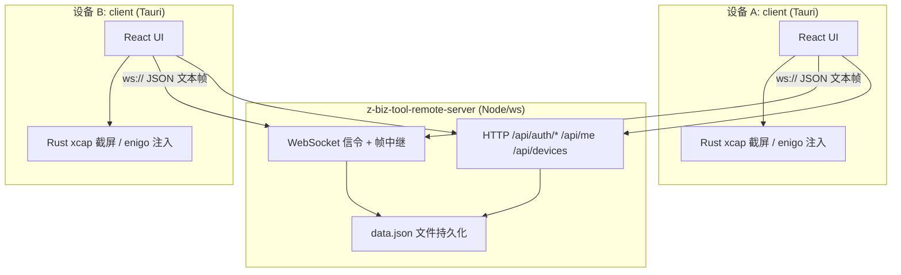

# 00 总览与优化优先级 — z-biz-tool-remote

> 优化状态：部分落地
> **落地率（2026-10-20 逐条核对 05 的 73 条任务）**：**15 条已落地 / 58 条未落地**
> （逐条状态与可复跑的判定脚本见下方「落地状态复核表」与
> [scripts/check_05_tasks.py](../../scripts/check_05_tasks.py)）。
>
> **2026-10-26 家族交互契约轮**：S1-B16 / Z-08（一键互控真正建会话、
> `CONTROL_ACCEPT` 认客户端真实字段 `fromId`、`sameUser` 由服务端计算）已闭合；
> 登录页 900×600 可滚、设备表窄屏可读、退出/允许控制两类确认默认焦点归「取消/拒绝」。
> 证据与未验证项见 [08](./08_本轮深度优化实施记录.md) 的 2026-10-26 节。
>
> **2026-10-19 更新**：**P0 五条现已全部闭合**。
> - `P0-1 传输零加密`（客户端 `toWsUrl` 恒拼 `ws://`）→ **已落地**。
>   协议裁决收敛到 `storage.ts::describeWsUrl`（公网默认 `wss://`、
>   明文仅本机豁免、其余拒绝并提示），写死的公网 IP（`DEFAULT_SETTINGS.serverUrl`
>   与 `tauri.conf.json` 的 `exceptionDomain`）已删除，界面改为**如实显示实际连接方案**。
> - `P0-4 encryptionKey 是假加密`（服务端回落到字面量 `test-key`）→ **已落地**。
>   该字段**双侧删除**（服务端不再下发，客户端 store / types / App 同步移除）。
> - `P0-2 / P0-3 / P0-5` 仍维持 2026-10-05 的结论（由 `canRelay`、
>   `grantedPeers`、`listOnlineDevicesFor` 守住），本轮复核代码确认仍在。
>
> 实施记录见 [08_本轮深度优化实施记录](./08_本轮深度优化实施记录.md)。
> ⚠️ **「P0 五条已闭合」与「05 只有 15/73 落地」不矛盾**：P0 是 5 条子集，
> 05 的大表里还有 53 条**非 P0** 任务没做（S2–S5 几乎全未落地）——
> 上一轮的「P0 已闭合」只覆盖了台账里最紧急的那几条。

> 状态：**设计方案，未实现**
> 源码基线：`b086d92`（`git rev-parse --short HEAD` 于调研开始时，工作区 `nothing to commit, working tree clean`，**无原有未提交改动**）。当前 HEAD 为 `33b67e0`，由**外部自动化进程**（author `bot@z-biz-tool.com`）提交，`git show --stat` 确认**仅含本目录 7 份文档、未触及任何源码/配置/锁文件**；本方案未执行任何 `git add`/`commit`/`push`。
> 当前事实 = 静态代码证据（只读调研，未运行任何服务/构建/测试）
> 指标 = 拟定验收目标（**假设值，尚未实测**）

## 1. 项目定位与独特价值

`z-biz-tool-remote` 是 `z-biz-tool` 工具族中唯一的**跨机器远程控制类应用**：其它子项目是单机单进程、本地读写、失效后果限于本机；本项目是**双侧多进程 + 公网中继**、屏幕像素与键鼠事件**出网**、失效后果是**他人机器被操控**，安全等级等价于「远程 Shell + 远程屏幕」。

独特价值（值得继续投入的理由）：

1. **账号维度的「我的设备」一键互控**——同账号下多台自有设备免配对直连，这是 TeamViewer/AnyDesk 个人版与 RustDesk 共同的核心心智；本仓库已有账号体系雏形（[`auth.js`](../../z-biz-tool-remote-server/auth.js)）与设备归属表（[`storage.js`](../../z-biz-tool-remote-server/storage.js)）。
2. **自托管信令 + 单文件中继**——服务端仅依赖 `ws`（[`package.json`](../../z-biz-tool-remote-server/package.json) 单一依赖），可 `docker compose up` 落到私有机器，数据主权自持，这是相对商业方案最硬的差异点。
3. **Tauri 2 体积小、原生截屏/注入**——Rust 侧 [`capture.rs`](../../z-biz-tool-remote-client/src-tauri/src/capture.rs)（`xcap`）+ [`input.rs`](../../z-biz-tool-remote-client/src-tauri/src/input.rs)（`enigo`）已跑通，具备跨平台底座。
4. **双侧架构清晰**——`client` 与 `server` 各自独立打包、独立 CI、独立版本号，便于分别演进。

## 2. 双侧架构说明（本项目最容易误判的一点）

README 的表述（[`README.MD`](../../README.MD)）是「client = 主机/控制端，server = 信令服务器」。**这个表述与源码不一致，必须按源码理解：**

关键事实（均来自源码，非 README）：

- **同一个 Tauri 客户端同时承担「控制端」与「被控端」**，由 [`sessionStore.ts`](../../z-biz-tool-remote-client/src/stores/sessionStore.ts) 的 `role: "host"|"client"|null` + `isHosting`/`isControlling` 切换，视图在 [`App.tsx`](../../z-biz-tool-remote-client/src/App.tsx) 的 `view.kind` 上分发（`login`/`main`/`hosting`/`controlling`）。**不存在独立的「被控端 App」**。
- **服务端不只是信令，它同时是媒体中继**：屏幕帧走 `SCREEN_FRAME`、输入走 `INPUT_EVENT`（均在 [`server.js`](../../z-biz-tool-remote-server/server.js) 内 fan-out/转发）。即 **P2P 未实现、全部流量过服务器**；`package.json` 的 `keywords` 写了 `webrtc` 但仓库内无任何 WebRTC 代码（属元数据声明，非实现证据）。
- **仓库根的 [`src/agent/`](../../src/agent) 与 [`src-tauri/`](../../src-tauri) 是遗留孤儿**：`src/agent` 是 SQL Agent（`AgentManager.ts`/`SQLEditor.tsx`/`QueryHistoryViewer.tsx`），与远程控制无关且全仓无 import；`src-tauri/src/` 为空目录；根目录**没有 `package.json`**。

因此所有优化必须**同时落到 client 与 server 两侧**，任何只改一侧的方案都会造成协议不兼容。

## 3. 立即 P0（不做就别对外发布）

以下 5 条是「远程控制工具」这一品类的**红线**，均有明确代码证据，详见 [01_现状审计与问题清单](./01_现状审计与问题清单.md) 与 [04_数据安全与可靠性](./04_数据安全与可靠性.md)：

| 编号 | P0 项 | 证据位置 | 风险 | 状态 |
| --- | --- | --- | --- | --- |
| P0-1 | **传输零加密**：客户端 `toWsUrl()` 恒定拼 `ws://`，无法走 `wss://`；默认服务器是硬编码公网 IP | [`storage.ts`](../../z-biz-tool-remote-client/src/services/storage.ts) `describeWsUrl` / `toWsUrl` / `DEFAULT_SETTINGS.serverUrl` | 屏幕画面、键鼠事件、Bearer Token 全程明文过公网 | ✅ **已闭合**（2026-10-19，见 [08](./08_本轮深度优化实施记录.md)） |
| P0-2 | **`INPUT_EVENT` 服务端零鉴权**：只按 `targetId` 查 socket 直接转发，不校验发送者是否属于该 session、不校验 sessionToken | [`server.js`](../../z-biz-tool-remote-server/server.js) `handleMessage` 的 `INPUT_EVENT` 分支 | 任一登录用户只要猜到/枚举到 deviceId，即可向任意在线设备注入键鼠 | ✅ **已闭合**（2026-10-05，`server.js:599` `canRelay(targetId, deviceId, msg.sessionId)`；2026-10-19 复核仍在） |
| P0-3 | **被控端接收输入时不校验会话**：只判 `isHosting` 就 `invoke("simulate_input")` | [`App.tsx`](../../z-biz-tool-remote-client/src/App.tsx) INPUT_EVENT 监听段 | 与 P0-2 叠加 → 完整的远程接管链 | ✅ **已闭合**（`App.tsx:375` `grantedPeers.current.has(msg.fromId)`；2026-10-19 复核仍在） |
| P0-4 | **`encryptionKey` 是假加密**：服务端回落到字面量 `"test-key"`，客户端存进 store 后**从未用于任何加解密** | [`server.js`](../../z-biz-tool-remote-server/server.js) `REGISTER_SUCCESS` 分支 / [`sessionStore.ts`](../../z-biz-tool-remote-client/src/stores/sessionStore.ts) | 给用户「已加密」的错觉，比不加密更危险 | ✅ **已闭合**（2026-10-19：该字段**双侧删除**，不再下发也不再存） |
| P0-5 | **`GET_ONLINE_DEVICES` 无租户隔离**：向任意已连接客户端返回**全量** deviceId 列表 | [`server.js`](../../z-biz-tool-remote-server/server.js) `GET_ONLINE_DEVICES` 分支 + `listOnlineDevicesFor()` | 为 P0-2 提供免费的 deviceId 枚举源 | ✅ **已闭合**（2026-10-05，`server.js:139` `listOnlineDevicesFor(user)`；2026-10-19 复核仍在） |

> P0-2 / P0-3 / P0-5 构成一条**可串联的攻击链**（枚举 → 注入 → 执行），且不需要破解加密、不需要中间人位置，只需一个能注册账号的网络位置。这是本项目当前最高优先级的单点问题，**优先于任何功能增强**。完整链路图与措施见 [04](./04_数据安全与可靠性.md) §0。

## 4. 分阶段能力路线（3–5 阶段概览）

详细任务编号、文件级改造点、前置依赖见 [05_实施路线与任务拆解](./05_实施路线与任务拆解.md)。

| 阶段 | 主题 | 核心产出 | 判定完成的一句话标准 |
| --- | --- | --- | --- |
| **S1 止血** | 安全红线 + 构建可用性 | wss 强制、INPUT_EVENT/SCREEN_FRAME 会话鉴权、租户隔离、Dockerfile & CI 修复 | 「明文不可用、越权不可达、镜像可构建」 |
| **S2 补齐已声明但不可用的能力** | 键盘输入、文件传输、聊天、一键互控 | ControlView 键盘事件、server 端 FILE_*/CHAT_* 路由、`sameUser`/`ephemeral` 真正落地 | 「UI 上存在的按钮，点了都有端到端效果」 |
| **S3 传输与性能** | 二进制帧、脏区/增量、带宽自适应、Rust 侧推流 | 帧率与延迟达标，CPU/带宽下降 | 「1080p@15fps 在 5Mbps 下行可稳定观看」 |
| **S4 可靠性与多会话** | 断线重连恢复、心跳统一、多显示器、并发会话 | 会话可恢复、被控端可控可断 | 「拔网线 30s 内自动恢复且不丢授权」 |
| **S5 体验与运维** | 被控端可见性、审计日志、i18n、跨平台持久化、Agent 边界 | 隐私指示灯、审计流、en-US、Windows 持久化 | 「被控端随时知道谁在看、能一键断」 |

## 5. 文档索引

| 文档 | 内容 |
| --- | --- |
| [01_现状审计与问题清单](./01_现状审计与问题清单.md) | 逐文件证据、行号、已确认缺陷 / 待验证假设 / 已存在能力三分类 |
| [02_产品能力与交互优化](./02_产品能力与交互优化.md) | 设备发现→配对→连接→屏幕→输入→多屏→会话→重连→文件→Agent 全流程缺口与优先级 |
| [03_技术架构与性能优化](./03_技术架构与性能优化.md) | 通信协议与传输、编解码、进程模型、连接生命周期、跨平台、并发多会话的**明确推荐** |
| [04_数据安全与可靠性](./04_数据安全与可靠性.md) | **重点**：认证配对、TLS、防中间人、会话授权、注入边界、危险操作确认、凭证存储、Agent 约束、Tauri 权限收敛、隐私 |
| [05_实施路线与任务拆解](./05_实施路线与任务拆解.md) | S1–S5 文件级改造点、任务编号、前置依赖、角色、资源假设、兼容与回滚 |
| [06_测试验收与风险清单](./06_测试验收与风险清单.md) | 单元/集成/E2E/故障注入/安全/性能测试矩阵、量化验收指标、风险与缓解 |

## 6. 四条不可妥协的核心原则

后续所有文档的方案都必须同时满足这四条，任何冲突以本节为准（详细展开见 [04](./04_数据安全与可靠性.md) §15）：

1. **传输必须加密**——生产环境不接受 `ws://`；`wss://` 为默认且可强制，自签证书需显式 pinning 而非静默放行。
2. **配对与认证必须双向可验证**——deviceId 不可被他人冒名 claim；session 参与方必须在服务端有成员表；控制请求必须携带可校验凭证。
3. **被控端永远可控可断**——被控端必须有持续可见的「正在被谁控制」指示、一键断开、一键暂停输入；`requirePermission` 不可被远端绕过；信任列表不可由远端写入。
4. **Agent 不得自动执行破坏性操作**——任何 Agent / 自动化路径都不得自主发起 `simulate_input`、文件写入、`shell` 调用；此类操作必须经真人显式确认，且确认记录可审计（详见 [04](./04_数据安全与可靠性.md) 第 8 节）。

## 7. 本次调研的验证限制（诚实声明）

- 全程**只读**：未执行 `npm install` / `cargo build` / `docker build` / `node server.js` / `npm test`，未发起任何网络请求。
- 所有「会失败」「不可用」的结论均为**静态代码推断**，区分方式见 [01](./01_现状审计与问题清单.md) §1；所有延迟/帧率/带宽/成功率数字均为**拟定验收目标 + 明示假设**，**不是实测结果**，汇总见 [06](./06_测试验收与风险清单.md) §3/§7。
- 对标 TeamViewer / AnyDesk / RustDesk 仅引用**公开的产品理念**（如「账号内设备互控」「被控端同意」「端到端加密」），不引用任何实时竞品事实、版本号或代码。

<!-- 05-STATUS-TABLE:START -->

## 落地状态复核表（2026-10-20 逐条核对 05 的 73 条任务）

**量法**：逐条查**当前代码**的实际状态，判据在 [scripts/check_05_tasks.py](../../scripts/check_05_tasks.py) 里，**可复跑**（`python3 scripts/check_05_tasks.py`）。

⚠️ **判据本身踩过三个坑，都已修**（记在这里，免得下一个人重踩）：

1. **注释里的历史叙述不算命中** —— `grep -rq "test-key"` 命中的是 e2e 测试里
   「原实现回落到写死的 test-key」那句**注释**，台账明明标了已落地，尺子却报未落地。
   ⇒ 判据改为**先剥注释再搜**。
2. **字符串存在 ≠ 功能生效** —— `allowClipboardSync` 只出现在 storage 的类型与
   默认值里，没有任何消费方读它；`"windows"` 出现在 `bundle.targets` 里，
   不等于有 `bundle.windows` 段。⇒ 判据改为**查消费方 / 用 JSON 路径取值**。
3. **命中位置要具体** —— 「有 SESSION_CREATED」判不出「是否合并了重复声明」，
   改成**数出现次数**（1 = 已合并）。

| # | 任务 | 状态 | 判定依据 |
| --- | --- | --- | --- |
| S1-A01/A02 | 删除 `COPY src ./src`（L18）；`CMD` 改 `["node","server.js"]`（L35）；改为 COPY 明 | **已落地** | Dockerfile 不再 COPY src ./src，改 COPY 具体 js |
| S1-A03 | 加 `defaults.run.working-directory`；server job 指向 `z-biz-tool-remote-se | **已落地** | ci.yml 有 defaults.run.working-directory |
| S1-A04 | 修正非法 YAML：把 `pull_request:` 从 `workflow_dispatch:` 下提到 `on:` 顶层（L9–L13 | **已落地** | build-server.yml 的 pull_request 在 on 顶层 |
| S1-A05 | `--bundles` 按平台分别设置（L67）：macOS=`app,dmg`、windows=`msi,nsis`、ubuntu=`de | **未落地** | build-client.yml 有 --bundles 分平台参数 |
| S1-A06 | `compute_next` 支持 `--major/--minor/--patch`（L155–L162）；`--both` 时 clie | **未落地** | release.sh 的 compute_next 支持 --major/--minor/--patch |
| S1-A07 | 移除 `use std::os::unix::fs::*`（L16），权限设置包进 `#[cfg(unix)]`；`HOME`（L71–L7 | **已落地** | persistent_storage.rs 去掉 std::os::unix 直接 import |
| S1-A08 | 补 `bundle.windows`(nsis+msi) 与 `bundle.linux`(deb+appimage) 段（L41–L45） | **未落地** | tauri.conf.json 的 bundle 段有 windows（nsis+msi）与 linux（deb+appimage） |
| S1-A09 | 补 token 获取与传入（L5/L8），使其对现行 server 可用 | **未落地** | e2e-protocol.mjs 带 token |
| S1-A10/A11 | 删除指向不存在文件的 `"server"` 脚本（package.json L16）；删除 `push.sh`（`git push orig | **未落地** | client package.json 不再有 server 脚本 |
| S1-B01 | 引入会话成员表 `sess.clients: Map<deviceId,{role,joinedAt,state,permission}>` | **未落地** | server.js 有 assertSessionMember |
| S1-B02/B03/B04 | 三个分支统一前置 `assertSessionMember`：`INPUT_EVENT` 校验成员+`role=client`+`permi | **未落地** | server.js 用 assertSessionMember 前置校验 |
| S1-B05 | `upsertDevice` 遇 `userId` 不同则抛 `DEVICE_CONFLICT`（storage.js L136–L147） | **未落地** | storage.js 抛 DEVICE_CONFLICT |
| S1-B06 | `WebSocketServer` 设 `maxPayload`（信令 64KB）；`send()` 检查 `bufferedAmount` | **未落地** | server.js 设了 maxPayload |
| S1-B07 | token 移出 URL query：`extractToken`（L120–L131）改为握手后首条 `HELLO{token}` 鉴权， | **未落地** | server.js 不再有 extractToken（token 移出 URL） |
| S1-B08 | 生产断言：`NODE_ENV=production` 且无 `TLS_KEY_PATH` → `process.exit(1)`（仿 L49 | **已落地** | server.js 有 NODE_ENV=production 断言 |
| S1-B09/B10 | 双侧删除假加密：移除 `REGISTER_SUCCESS.encryptionKey` 与 `"test-key"` 回落（server.j | **已落地** | 服务端不再下发 encryptionKey |
| S1-B11 | `toWsUrl`（L310–L319）默认 `wss://`，仅 `localhost`/`127.0.0.1`/`.local` 允许  | **已落地** | storage.ts 不再硬编码公网 IP |
| S1-B12 | `buildWsUrl`（L247–L260）不再拼 token；`openSocket` 后发 `HELLO`；重连改指数退避+抖动（L4 | **已落地** | signaling.ts 的 buildWsUrl 不拼 token |
| S1-B13/B14 | 被控端 `INPUT_EVENT` 监听（L327–L342）加 `sessionId`/来源/`inputPaused` 校验，删除 `/ | **未落地** | App.tsx 的 INPUT_EVENT 监听带 sessionId 校验 |
| S1-B15 | `simulate_input(event, origin)`：`origin.source=="automation"` 无条件 `Err | **未落地** | commands.rs 在 Rust 侧生效 inputPaused |
| S1-B16 | `CONTROL_REQUEST` 透传 `requestedPermission` 与 `sasHash`（L443–L458）；真实计算 | **未落地** | server.js 透传 requestedPermission 与 sasHash |
| S1-B17 | 速率限制（登录/注册/刷新/`JOIN_SESSION`/配对码）；`sessionId` ≥16B、`sessionToken` ≥32B | **已落地** | server.js 用 crypto.randomBytes 生成 sessionToken |
| S1-B18 | 新增 `LEAVE_SESSION{sessionId,reason}` 路由，替代 `closeSession()` 发 `PONG` 的 | **未落地** | server.js 有 LEAVE_SESSION 路由 |
| S1-C01/C02 | 移除 `fs:default`(L22) 与 `shell:default`(L23)（源码零调用的无用高危授权）；`app.securit | **未落地** | capabilities/default.json 不再有 fs:default |
| S1-C03 | `HistoryRecord` 移除 `sessionToken` 持久化（L339–L345）；升级时一次性清理已有记录 | **未落地** | storage.ts 的 HistoryRecord 不持久化 sessionToken |
| S1-C04 | token 迁出 `localStorage`（L195–L202）与 `state.json`（L60–L66）到 OS 密钥库；`sta | **未落地** | persistentStorage.ts 用 OS 密钥库存 token |
| S1-C05 | `doWrite`（L68–L73）设文件 `0600`/目录 `0700`；refresh token 改存 SHA-256 散列 | **未落地** | server/storage.js 的 doWrite 设 0600 |
| S1-D01 | 常驻浮条「正在被 X 控制 + 时长 + 权限档位」；`sessionToken` 默认遮罩、点显示后 10s 自动遮罩（L33–L49） | **未落地** | HostingView.tsx 有常驻控制浮条（真显示「正在被控制」这类文案） |
| S1-D02 | 三按钮「暂停输入 / 仅观看 / 立即断开」（断开为 L0 无确认）；`inputPaused` 下发到 Rust | **未落地** | HostingView.tsx 有暂停输入/仅观看/立即断开 |
| S1-D03 | `onStop`（L21–L27）改为发 `LEAVE_SESSION` 并等 `SESSION_CLOSED` 再清本地 | **未落地** | HostingView.tsx 的 onStop 发 LEAVE_SESSION |
| S1-D04 | 通知改 Tauri `notification` 插件（跨平台），替换仅 macOS 的 `send_system_notification | **已落地** | commands.rs 用 Tauri notification 插件 |
| S2-01/03 | 补 `onKeyDown`/`onKeyUp`（L112–L140），用 `e.code` 物理键位 + `preventDefault`， | **未落地** | ControlView.tsx 有 onKeyDown/onKeyUp 键盘捕获 |
| S2-02 | `JOIN_SUCCESS` 分支补 `setView({kind:"controlling"})`（App.tsx L188–L202）+ | **已落地** | App.tsx 的 JOIN_SUCCESS 分支切到 controlling 视图 |
| S2-04 | 补 `FILE_OFFER/ACCEPT/REJECT/PROGRESS/DONE/FAIL` 与 `CHAT_MESSAGE` 路由（成员 | **未落地** | server.js 有 FILE_OFFER 路由 |
| S2-05/06 | 发送改原始字节分块（弃 `readAsDataURL`+`substring`，L93–L134）；接收补拼装 + sha256 校验 +  | **未落地** | FileTransferPanel 不用 readAsDataURL（改原始字节分块） |
| S2-07 | 挂载 `ChatPanel` 为右侧抽屉（复用 `_shared/CollapsiblePanel.tsx`）；远端内容纯文本渲染 | **未落地** | MainView.tsx 挂载 ChatPanel |
| S2-08 | 让 `allowClipboardSync`/`allowFileTransfer`/`allowChat` 产生真实效果（否则从 UI 移 | **未落地** | allowClipboardSync 有**消费方**（不只是类型与默认值） |
| S2-09 | 配对码机制 `PAIR_OFFER`/`PAIR_ANSWER`（6 位、TTL 150s、一次性、5 次失败作废）+ SAS 计算下发 | **未落地** | server.js 有配对码 PAIR_OFFER/PAIR_ANSWER |
| S2-10/11 | 授权弹窗展示设备名/账号/SAS/请求档位 +「允许/拒绝/允许并记住 30 天」+ 30s 超时自动拒绝；`trusted` 加 `exp | **未落地** | 授权弹窗展示 SAS 与权限档位 |
| S2-12/13 | 补 `KeyHotkey` variant 或删除 TS 侧 `key-hotkey`；`screen-select` 改走 `SELECT | **未落地** | screen-select 权限在 capabilities 里声明 |
| S2-14 | `SESSION_MEMBERS` 查询与变更推送；`KICK_CLIENT`（校验发起者为 host） | **未落地** | server.js 有 SESSION_MEMBERS / KICK_CLIENT |
| S2-15/16 | 合并重复声明的 `SESSION_CREATED`（L18–L23 与 L74–L81）；`window.prompt`/`confirm` | **已落地** | server.js 合并重复的 SESSION_CREATED |
| S2-17 | 错误码表 → 用户可读原因 + 下一步动作（替 `message.error(String(e))`） | **已落地** | 错误码表 → 用户可读原因（不再是 message.error(String(e))） |
| S2-18 | 孤儿目录清理（见 [03](./03_技术架构与性能优化.md) §10） | **未落地** | server.js 有孤儿目录清理 |
| S2-19/20 | 补齐 `DATA_FILE`/`NODE_ENV`/`ALLOWED_ORIGINS`/`TLS_*`，`AUTH_TOKEN` 标 dep | **未落地** | server.js 有 ALLOWED_ORIGINS / AUTH_TOKEN_TTL 等环境变量 |
| S3-01 | 信令/媒体双通道分离，媒体通道 `maxPayload=8MB` + 二进制转发（不 `parse`） | **未落地** | 媒体通道独立且 maxPayload=8MB |
| S3-02 | 二进制帧头编解码（24+4B，见 [03](./03_技术架构与性能优化.md) §2.2） | **未落地** | 二进制帧头编解码（24+4B） |
| S3-03 | 引入 `tokio`+`tokio-tungstenite`；`start_capture/stop_capture`；帧从 Rust 直发 | **未落地** | client 引入 tokio + tokio-tungstenite |
| S3-04 | 脏区 tile 编码（64×64、8 采样点、THRESH=12、keyframe 每 30 帧、>40% 退回全帧） | **未落地** | 脏区 tile 编码 |
| S3-05/06 | 显示器句柄缓存（A-1）；`JpegEncoder` 直写 `Vec<u8>`（A-6）；缩放算法可配（A-3，L61/L85–L108）； | **未落地** | JpegEncoder 直写 Vec<u8> + 缩放算法可配 |
| S3-07/08 | `Enigo` 改 `thread_local!` 复用（L76–L78）；release profile 分包 `[profile.rel | **未落地** | Enigo 用 thread_local! 复用 + release profile 分包 |
| S3-09 | 带宽自适应 5 档 + 2s 评估 + 滞回；降级序 fps→质量→分辨率 | **未落地** | 带宽自适应 5 档 + 滞回 |
| S3-10 | `` 改 `<canvas>` + `createImageBitmap`；tile 贴回与 keyframe | **已落地** | 截图贴回用 canvas + createImageBitmap |
| S3-11 | `SCREEN_FRAME` 透传 `seq`/`captureTsMs`（L496）；统一应用层 `PING/PONG{ts}`（L285 | **未落地** | SCREEN_FRAME 透传 seq / captureTsMs |
| S3-12/13 | 显示 RTT/fps/码率/当前档位；三个裸露滑块收敛为 4 个语义预设（流畅/平衡/清晰/自定义）（L130–L166） | **未落地** | 显示 RTT/fps/码率 + 滑块收敛为 4 个语义预设 |
| S3-14 | 采集循环退役（改由 Rust 推流），JS 侧仅保留统计事件订阅 | **未落地** | JS 侧采集循环退役（Rust 推流） |
| S4-01 | 会话宽限期 30s + `graceUntil` + `CLIENT_STALE` 广播 + `RESUME_SESSION{resumeT | **未落地** | 会话宽限期 graceUntil + CLIENT_STALE 广播 |
| S4-02/03 | 重连成功后自动 `RESUME_SESSION`，失败显式回落 `main` 视图，成功后发 `REQUEST_KEYFRAME`；超 2× | **未落地** | 重连成功后自动 RESUME_SESSION |
| S4-04/09 | 统一 `state_dir()`/`notify()`/`check_capture_permission()`/`key_map()`（X | **未落地** | 统一 state_dir() / notify() / check_capture_permission() |
| S4-05 | macOS 权限自检向导：复用 [`examples/smoke.rs`](../../z-biz-tool-remote-client/s | **未落地** | macOS 权限自检向导 |
| S4-06/07 | 并发上限保护（被控 2 路 / 会话观看者 3 / 实例连接 2000 / 活跃会话 200），超限回 `CAPACITY_EXCEEDED | **未落地** | 并发上限保护（超限回 CAPACITY） |
| S4-08 | 换 `better-sqlite3`（事务 + 索引），解决全量重写（L60–L73）与 O(n) 查找（L84–L135）；含 JSON→ | **未落地** | server 换 better-sqlite3 |
| S4-10 | 多会话标签页（单路活跃推流）+ `PAUSE_STREAM`/`RESUME_STREAM` | **未落地** | 多会话标签页 + PAUSE_STREAM/RESUME_STREAM |
| S5-01 | X25519 + HKDF-SHA256 + ChaCha20-Poly1305 帧加密；nonce 绑定 `sessionId\ | **未落地** | 帧加密 X25519 + ChaCha20-Poly1305 |
| S5-02 | 证书校验与 SPKI SHA-256 TOFU pinning；pin 不一致硬失败；pin 变更走 L2 确认 | **未落地** | 证书校验 + SPKI SHA-256 TOFU pinning |
| S5-03 | 危险操作三级确认（L1 `Popconfirm` / L2 列后果+具体动词 / L3 输入指定词+审计） | **已落地** | 危险操作三级确认（Popconfirm / 后果+动词 / 输入指定词） |
| S5-04 | 审计事件最小集（AU-01…AU-09）；只追加；日志脱敏中间件 + CI 断言禁止输出 token | **未落地** | 审计事件最小集 AU-01…AU-09 |
| S5-05 | 被控端可查看会话成员与最近注入事件采样（环形缓冲 1000 条） | **未落地** | 被控端可查看会话成员与注入事件采样 |
| S5-06 | 补 `en-US` 字典 + 语言选择器（或先移除 `en-US` 选项避免虚假承诺）（L4/L88–L89） | **未落地** | en-US 有**字典**（不只是 language 字段的一个取值） |
| S5-07/08 | 设备/历史/传输列表统一空态/错态/载态；全局快捷键 `Cmd/Ctrl+Shift+{F 全屏, M 聊天, T 传输, D 切屏, Es | **未落地** | 统一空态/错态/载态 + 全局快捷键 |
| S5-09 | 3 步：填服务器 → 登录 → 授予屏幕录制/辅助功能权限 | **未落地** | 3 步引导（服务器 → 登录 → 授权） |
| S5-10/11 | 设备状态改服务端推送 `DEVICE_STATE_CHANGED`，30s 轮询降为 5min 兜底（L85–L102）；`Registry | **未落地** | 设备状态改服务端推送 DEVICE_STATE_CHANGED |
| S5-12 | 接入 `npm audit --production` + `cargo audit`（高危阻断）、覆盖率门禁、`clippy`/`fmt` | **未落地** | CI 接入 npm audit / cargo audit / 覆盖率门禁 |

**汇总：15 条已落地 / 58 条未落地**（表 73 行，与抬头一致）。

> **本表与上一轮「P0 五条现已全部闭合」不矛盾**：P0 是 5 条子集，
> 且 S1-B09/B10、S1-B11、S1-B12、S1-B17、S1-D04、S2-02、S2-15/16、S2-17、
> S3-10、S5-03 等**非 P0** 任务也落地了；而 S2–S5 的绝大多数仍未做。
<!-- 05-STATUS-TABLE:END -->
